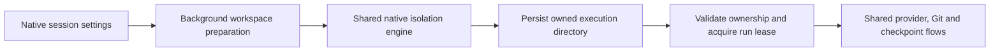
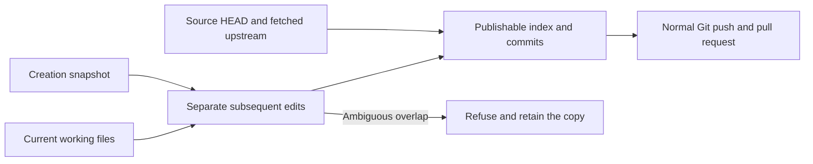

# Native work isolation

The GPUI preview supports Local, Git worktree, and native copy-on-write sessions.
Choose **New copy-on-write** in the composer's **Isolation** menu, or select a
default in **Settings → Work Isolation → Start new session on**. CoW requires
APFS on macOS or Btrfs on Linux. Unsupported filesystems and Windows fail
explicitly rather than copying normally or running in the source checkout.

The project menu uses **Switch working copy** and **Search working copies…**.
Existing copies carry a copy icon and open their owning conversation. A new tab,
split, account-switch conversation, or transferred response starts an independent
copy when its source is a CoW session. Quick Composer and fresh automation runs
can also request copy-on-write. Explicit local/existing-worktree choices override
pending isolation defaults.
Selecting new copy-on-write from an existing checkout preserves that checkout
as the source, including in Quick Composer and app-launched sessions.

Mono and Operator `sessions.start` calls accept `workspaceMode: "cow"` and an
optional `worktreeBase`. Phone session creation also accepts `"cow"`; unknown
modes are refused. Projects opened in a repository subfolder keep that folder
as their execution directory inside the copy. Generated branch names and code
contribution tracking use the private checkout.

Preview.14 integration preserves its shared provider/model/account/access defaults
for new tabs and splits. Starting chats or terminals from a terminal pane resolves
the owning conversation and checkout, including restored panes.

## Feature UI coverage since preview.1

| Surface | Copy-on-write behavior |
| --- | --- |
| Session composer, new tabs and splits | Isolation menu and app default; child chats fork independent copies. |
| Quick Composer | New copy-on-write choice; preserves the selected source checkout. |
| Automations | Fresh copy-on-write for each run. |
| Mono settings → Sessions it starts | Isolation default independent of model/effort; explicit working-copy requests win. |
| Mono Overview → Changes | Registered copies appear as labeled working copies under their assigned project, including subfolder projects; copies remain selectable after commit and disappear after removal. |
| Inbox issues and failing checks | Session isolation selector applies to Open in new session and Fix with agent; App isolation default follows Settings. |
| Notes → Open in new session | Uses the app isolation default; the draft composer can override it before sending. |
| Phone project header and composer | New copy-on-write appears only after the connected desktop confirms support for that project. |
| Phone Mono profile → Sessions it starts | Isolation default appears only when the desktop advertises support for this setting. |
| Terminal panes and title tabs | Keep their owning checkout; cleanup checks live shell and foreground directories. |

Mono habits and heartbeats run coordination sessions from the home directory.
Their project sessions use the Mono's Sessions it starts isolation setting;
selecting CoW there creates a fresh copy for each delegated project session.
The coordination session itself does not clone the home directory.
Phone changes require an updated companion app as well as this desktop build.

## Filesystem behavior

| Host and filesystem | Clone operation | Behavior |
| --- | --- | --- |
| macOS / APFS | `fclonefileat` | Existing APFS behavior. |
| Linux / Btrfs | `FICLONE` reflink | Private file metadata with shared data extents; writes remain private. |
| Other filesystems / Windows | None | Explicit refusal; no ordinary-copy or hard-link fallback. |

The repository and its sibling copy directory must use a supported filesystem.
Source files and destinations must belong to the same filesystem for reflinking;
external links or Git object stores on another volume are refused when they cannot
be cloned. Repositories that are Btrfs subvolumes can create sibling copies on
Linux 5.18 or newer. Nested filesystem/subvolume boundaries inside a captured tree
remain unsupported.

The Btrfs backend creates each destination exclusively, through an owned directory
handle, and matches the source's NOCOW/checksum policy before reflinking. It never
changes source attributes. A failed reflink removes its new destination and creation
recovery retains its existing ownership checks. Neither backend clones a whole disk
or a home directory.
Normal Btrfs copies use the current user's file descriptors and need neither
`sudo` nor `btrfs-progs`; those tools and mount permissions are needed only for
the disposable filesystem integration test setup.

## Shared execution and review



`monocode-core::isolation` calls the existing `monocode-isolation` library
directly. The GPUI app does not launch a Tauri helper or maintain separate CoW
Git/Changes screens. Provider requests, staging, commits, push, pull requests,
file previews and checkpoints use the resolved execution directory. File/Git
requests from a paired phone can access registered same-project copies; new
sessions cannot attach to another copy's owner.

Copies preserve the current checkout, including its uncommitted files. Those
inherited edits are private execution context. Changes, partial staging, commit
message generation, commits and publication include only changes made after the
copy was created. Untracked files and deletions inherited at creation are excluded
too. Discarding new edits restores the inherited working contents.



The Git index and branch use publishable contents while the real working files
retain inherited contents. Raw `git status` can therefore still show inherited
edits. Native Changes compares projected trees and hides those edits. Normal Git
commits run the same projection through a pre-commit hook; pre-push refuses private
history containing inherited edits. Providers are instructed to keep these hooks
enabled. This remains ordinary provider access, without an OS sandbox: deliberately
bypassing Git hooks or using a client that ignores them bypasses the CLI guard.

Disjoint text edits in the same file can be separated. Overlapping changes, binary
ambiguity, edits to inherited untracked files that require their old contents, and
newly tracked files ignored at creation fail explicitly instead of publishing the
inherited contents. The working copy and index remain available for recovery.
Use a clean worktree to review and recreate a change that cannot be separated.

Native publication repairs separable unsigned legacy commits before committing or
pushing. It retains their original history under `refs/monocode/private/<copy-id>/`.
Signed commits requiring rewriting are refused. Existing remote history is never
force-pushed automatically. Normal signed commits whose trees and parents already
match the policy keep their signatures.
Fetched upstream commits remain intact. The inherited runtime baseline is merged
onto that upstream base, so discard retains upstream work and reverting a published
edit remains visible. Conflicting inherited/upstream changes and multiple
incomparable upstream histories are refused. Updating the index checks both its
captured contents and HEAD so concurrent staging is retained.

Orchestration workers fork independent copies from the lead. A successful worker
integrates only changes since its creation into the lead copy before dependent
tasks start. Integration holds exclusive native leases on both copies and refuses
files changed differently in the lead. A failed integration retains the worker
copy and includes its location and error in the coordinator's report. Worker
commits remain in the worker copy; the lead receives their file changes.
Stopping a run stops further dispatch and provider work; an integration already
queued is allowed to finish under its leases.

Provider startup checks ownership at the runtime boundary, including background
submissions, and rechecks it immediately before launching the provider. Native
run/removal leases prevent cleanup from racing another native provider run.
They coordinate native processes within one application instance; concurrent
Tauri/native mutation of the same database or workspace is not supported.

## Storage compatibility

The registry remains `<selected database directory>/isolation`, so native release
builds can recognize existing desktop copies and isolated development builds
cannot mutate the installed registry. Registry ownership uses the original
persisted session ID, not GPUI's numeric UI handle.

Working copies remain in project-sibling folders (`<project>-cow/<id>`). The
registry holds ownership and baselines, not the working files. Authorization
discovers those registered paths, including aliases and descendants, and then
checks the original directory identity and session owner.

Existing desktop CoW columns are read and written when available, including
authoritative SQL NULL values after another app clears isolation. Older schemas
use the native settings sidecar. The port does not alter existing desktop table
schemas or advance their migration version. Unknown desktop fields are retained.

## Cleanup

Archiving retains the working copy. Session deletion offers optional cleanup
without waiting for filesystem checks before showing confirmation. Cleanup runs
after durable session deletion and uses the same management path as Settings.
Errors retain the copy and are reported; no automatic force-delete is used.

Work Isolation settings list and reveal both workspace types. Before removing a
copy, the app checks terminals, file panes and running sessions, then rechecks UI
blockers after background preflight. The native engine validates registered directory
identity, refuses uncommitted changes, and preserves committed branches/history
before removing files. Public branches retain only publishable history; original
private history that cannot be separated is kept under `refs/monocode/private/` in
the source repository, outside ordinary branch/tag publication. No Git filters or
hooks run during cleanup. Session detachment is committed while holding the native
removal lease, before files are deleted; a failed filesystem cleanup still
returns that durable result to the UI. Selecting a retained copy can reattach
its original owner. Kept conversations are detached and must select a valid
working copy before they can run again. Idle provider processes are discarded
before removing their checkout.
Terminal blockers include dock tabs, live and restored terminal panes, and saved
dock tabs. On macOS and Linux, cleanup also checks the live shell and foreground process
directories, including hidden terminals that changed directory into the copy.
Unavailable live process information retains the copy.

## Preview limits and verification

Remote CoW execution is not supported by this native port. Both UI and remote-runtime
boundaries refuse a saved/pending remote CoW request; they never silently create a
current-checkout session. Ordinary remote worktrees retain their existing path.

Run the native checks and the engine's filesystem integration suite:

```sh
RUST_TEST_THREADS=1 MONOCODE_REQUIRE_COW=1 npm run native:check
MONOCODE_REQUIRE_COW=1 cargo test -p monocode-isolation
# Linux: requires btrfs-progs, sudo/mount permissions, and loopback support.
bash scripts/test-isolation-btrfs.sh
```

`native:check` includes the engine suite. The native macOS CI job requires APFS
support. A Linux CI job creates a disposable Btrfs loopback image and runs the
engine, publication, and core isolation tests with `MONOCODE_REQUIRE_COW=1`, so
unsupported filesystem coverage cannot silently skip. The Btrfs script unmounts
and removes only its temporary image; a failed unmount retains it for inspection.

Linux fixtures also cover NOCOW inheritance, exclusive destination creation,
failed-reflink cleanup, subvolume repositories, and refusal on tmpfs.
Integration fixtures use disposable databases and repositories. They cover
original desktop ownership IDs, private forks, source write isolation, active-run
cleanup refusal, committed-history retention, schema-preserving persistence, and
desktop-style clearing of native preferences. They also cover subfolder routing,
worker integration and conflicts, source-project validation, and branch naming.
Publication tests use disposable bare remotes and real Git hooks. They cover
partial staging, multiple commits, amend, push, discard, PR text, cleanup, inherited
untracked files and deletions, text and binary conflicts, clean filters, CRLF, and
legacy unsigned/signed history.
They also cover fetched upstream changes, legacy merges, reverting published work,
concurrent staging, and cleanup with staged edits whose working files were restored
to the creation snapshot.
GPUI tests cover composer selection, the settings radio group, new tabs, Quick
Composer project changes, phone authorization and remote refusal.
These checks do not open the installed user database or make live provider requests.
