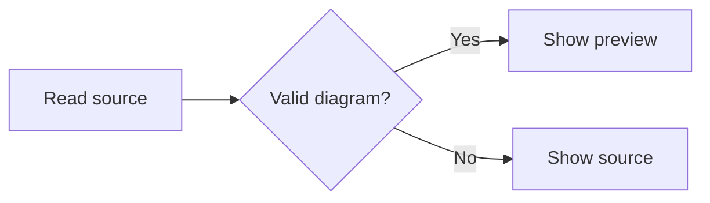
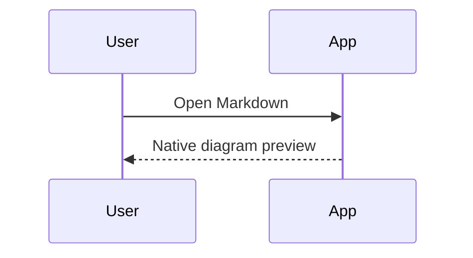

# Mermaid diagrams

The GPUI app previews fenced `mermaid` blocks in conversations, Markdown files,
notes, inbox documents, and skill documents. Rendering runs locally in Rust
using mermaid-rs-renderer 0.3.1 and GPUI's SVG rasterizer; no browser or Node.js
installation is needed.

Use **Source** to inspect the diagram text, **Diagram** to return to its preview,
and **Copy** to copy the original Mermaid source. The diagram follows the app's
light or dark theme. Source remains searchable and can be selected in chat.

Rendering waits briefly for streamed text to settle and runs off the UI thread.
Incomplete or unsupported diagrams show their source and an error, and retry
when the source changes. The panel follows the diagram's aspect ratio, up to
640 points tall, and fits the complete diagram inside it with equal top and
bottom padding as the window or sidebar changes width. Source scrolls within
the same panel. Flowchart connections use smooth curves with arrowheads.
Long sequence participant identifiers wrap inside both their top and bottom
boxes; copying still uses the original source.

This renderer is a native implementation of Mermaid, so layout and syntax
coverage can differ from Mermaid.js. Common flowchart, sequence, class, state,
and entity relationship diagrams are covered by integration tests. Mermaid.js
configuration directives, custom CSS, and interactive links are not applied by
the preview.

Previews accept at most 32 KiB of source, 512 source lines, and 256 combined
graph nodes and edges. Raster images are capped at 2048 pixels per side. Larger
diagrams retain their source and copy action. A cache of up to 32 diagrams and
32 MiB of image data preserves previews when scrolling them back into view.
Uncached diagrams show a loading placeholder, never a flash of source code.
The source panel displays at
most 32 KiB and 512 lines; Copy always includes the complete original source.

Before parsing, a conservative estimate limits grouped edges and class
assignments to 256 expansions. This includes chains and grouped endpoints;
complex inputs can fall back to source even when their final graph would be
smaller. Style command lines are limited to 2048 bytes and emitted style values
to 128 bytes of a restricted CSS value alphabet. Mermaid SVG parsing disables
all image resolution, including filesystem paths and nested data images.
