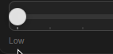
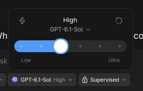
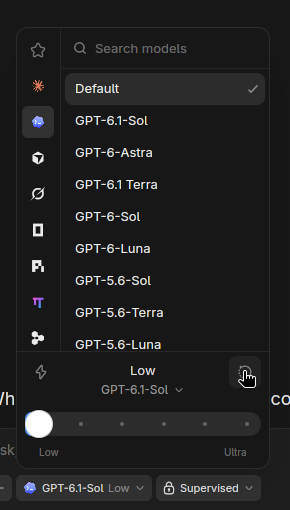

# Model controls

The native model control group uses the installed Codex Desktop UI as its
visual reference: Arch package `openai-codex-desktop 26.1029.61003-1`, read-only
packaged UI resources. In that build the product's
launcher is named ChatGPT. The model-picker stylesheet and component describe
`ModelPickerDropdownContent`, `ViewControls`, `FastModeToggle`, and the power
slider's `Track`, `ThumbScale` and `Thumb`.

The GPUI adaptation follows the reference's 254px menu, centered effort/model
header, 32px Fast action, 24px rounded track and 28px white thumb. It retains
MonoCode's provider rail and searchable catalog. Both views share the same
leading anchor and width; the controls span the entire footer, independently of
the provider rail. It is not an exact port of the
web component's graphics or its optional effects.

The slider has one horizontal travel rail, inset by the thumb radius (14px),
and one vertical center (20px). The track, fill, ticks and thumb use this same
coordinate system. Padding outside the hit area also leaves room for keyboard
focus and shadows at both endpoints. Motion is retained across renders and
retargeted from the current position; reduced motion settles immediately.

Effort stops come only from the selected model's catalog. Fast is exposed only
when the catalog supports a Fast boolean or an explicit `fast`/`priority` service
tier. The action uses the existing corresponding setting and save path; it does
not reinterpret Fast as a lower reasoning effort. The reset action restores the
model's supported default effort. Choosing the centered model label opens the
searchable model list.

Official behavior reference: [Codex speed configuration](https://developers.openai.com/codex/speed/).

Targeted GPUI tests cover endpoint/midpoint geometry, supported effort choices,
mouse capture, keyboard navigation, interrupted animations, reduced motion,
model-list opening and durable Fast settings for boolean and tier-based catalogs.

## UI

Before:

After:

